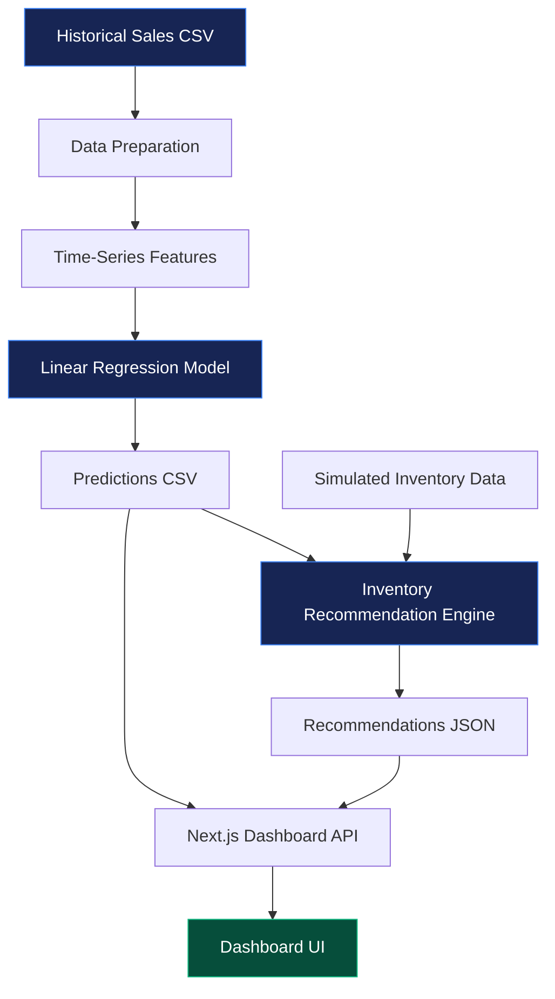

 <div align="center">

# NEXUS

### Medicine Demand Forecasting & Inventory Intelligence

**Forecast demand. Understand inventory. Make better replenishment decisions.**

A machine-learning-powered prototype connecting pharmaceutical demand forecasting with inventory decision support — transforming historical sales data into forecasts, suggested orders, and stock-risk indicators.

<br/>


[Overview](#-the-idea) · [Architecture](#-how-it-works) · [Model](#-forecasting-engine) · [Setup](#-run-it-locally) · [Limitations](#-responsible-use)

</div>

---

## 🔭 The Idea

Hospitals and pharmacies must balance two competing risks: **running out of essential stock** and **ordering more than they need**.

NEXUS explores how historical pharmaceutical sales patterns can help estimate upcoming demand and how those forecasts can feed an inventory recommendation engine.

Instead of treating machine learning as an isolated prediction, NEXUS connects the forecast to a practical next step: **a suggested replenishment quantity with inventory risk indicators.**

> **From historical data → to demand forecasts → to inventory decisions.**

### ✦ What NEXUS does

| Capability | What it contributes |
|---|---|
| 📊 Historical data processing | Reshapes and prepares monthly pharmaceutical sales data |
| 🧠 Demand forecasting | Uses time-series features and Linear Regression |
| 📏 Model evaluation | Compares predictions against a naive baseline |
| 📦 Inventory intelligence | Combines predicted demand with stock and safety-stock inputs |
| ⚠️ Risk assessment | Produces stockout and expiry risk indicators |
| 🖥️ Interactive dashboard | Presents forecasts and recommendations in a web interface |

## ⚙️ How It Works



**The pipeline has three main stages:**

1. **Forecast:** Python processes historical data, engineers features, evaluates the model, and generates next-month demand predictions.
2. **Recommend:** The inventory engine combines predictions with simulated stock, incoming inventory, safety stock, and supplier information.
3. **Visualize:** The Next.js API reads the generated CSV and JSON files and supplies the results to the dashboard.

## 🧠 Forecasting Engine

The forecasting implementation lives in `src/forecasting/train_model.py`.

### Feature engineering

The model uses historical demand signals to represent recent behavior and time:

- Previous-month demand: `lag_1`
- Demand from two and three months earlier: `lag_2`, `lag_3`
- Three- and six-month rolling averages
- Calendar month and sequential time index
- One-hot encoded pharmaceutical category

### Model selection

NEXUS compares two forecasting approaches:

| Approach | Method |
|---|---|
| Baseline | Previous month's demand |
| Forecast model | Linear Regression with engineered features |

The final model is retrained on all feature-ready historical observations before generating the next-month forecast.

### Evaluation results

The following results come from the project's reported chronological test evaluation.

| Metric | Naive baseline | Linear Regression |
|---|---:|---:|
| MAE ↓ | 62.30 | **60.91** |
| RMSE ↓ | 133.85 | **118.24** |
| MAPE ↓ | **46.45%** | 48.89% |

<details>
<summary><strong>How should these results be interpreted?</strong></summary>

Lower MAE and RMSE indicate smaller errors under those metrics, and Linear Regression performs better on both here. However, its MAPE is higher, so it does not outperform the baseline on every measure.

This is why the prototype evaluates against a baseline instead of presenting the machine-learning model as automatically superior.

</details>

## 📦 From Predictions to Inventory Decisions

The integration layer connects the forecasting model to the inventory engine.

For each pharmaceutical category, the pipeline combines predicted demand with inventory inputs such as:

- Current and incoming stock
- Safety stock
- Supplier lead time
- Unit cost
- Days to expiry and quantity expiring

The recommendation engine then produces outputs such as:

| Output | Purpose |
|---|---|
| Predicted demand | Estimated upcoming demand |
| Recommended order | Suggested replenishment quantity |
| Days of supply | Estimated stock coverage |
| Stockout risk | Inventory shortage risk indicator |
| Expiry risk | Potential expiry risk indicator |

These recommendations demonstrate the connection between forecasting and inventory planning; they are not validated purchasing instructions.

## 🖥️ Technology Stack

<div align="center">

| Layer | Tools |
|:---|:---|
| Data & preprocessing | Python · pandas · NumPy |
| Machine learning | scikit-learn · Linear Regression |
| Inventory logic | Python · Rule-based calculations |
| Web application | Next.js · React · TypeScript |
| UI & visualization | Tailwind CSS · Recharts · Lucide React |
| Testing | pytest |

</div>

## 🚀 Run It Locally

### Prerequisites

- Python 3.13 or a compatible Python version
- Node.js and npm
- Git

### 1. Clone the project

```bash
git clone https://github.com/asadasjad/hospital-medicine-forcast.git
cd hospital-medicine-forcast
```

### 2. Install Python dependencies

```bash
python3 -m venv .venv
source .venv/bin/activate
python -m pip install -r requirements.txt
```

### 3. Generate forecasts

Run from the project root:

```bash
python -m src.forecasting.train_model
```

This generates:

`output/predictions.csv`

### 4. Generate inventory recommendations

```bash
python -m src.integration.run_pipeline
```

This generates:

`output/inventory_recommendations.json`

**Run these two commands in order.** The integration pipeline needs the prediction file produced by the forecasting step.

### 5. Launch the dashboard

Open a separate terminal:

```bash
cd app
npm install
npm run dev
```

Visit [http://localhost:3000](http://localhost:3000).

The dashboard expects both generated files to exist in the repository's root `output/` directory.

### 6. Run tests

From the project root, with the virtual environment activated:

```bash
python -m pytest -q
```

## 🗂️ Project Structure

```text
hospital-medicine-forcast/
├── app/                         # Next.js dashboard
│   └── app/
│       └── api/dashboard/       # Dashboard data endpoint
├── data/
│   └── raw/
│       └── salesmonthly.csv     # Monthly sales dataset
├── output/
│   ├── predictions.csv          # Model forecasts
│   └── inventory_recommendations.json
├── src/
│   ├── data/                    # Data exploration
│   ├── forecasting/             # Forecasting model
│   ├── integration/             # End-to-end pipeline
│   └── inventory/               # Inventory engine
├── tests/                       # Automated tests
├── requirements.txt
└── README.md
```

## 🧪 Testing & Reproducibility

The repository includes automated tests for the inventory logic. Run them using `python -m pytest -q`.

The forecasting and inventory steps can also be rerun from the project root to regenerate their output files. For meaningful comparisons, retain the same dataset and evaluation procedure.

## 🛡️ Responsible Use & Limitations

NEXUS is an **academic proof of concept**, not a production hospital inventory system.

- The sales dataset contains eight pharmaceutical categories, not individual medicine-level records.
- Historical sales are a proxy for demand and may not capture unmet demand or changing clinical needs.
- Model accuracy varies by evaluation metric and category.
- Inventory values are simulated and are not actual hospital stock records.
- Recommendations depend on configured inventory rules and assumptions.
- The prototype has not been validated for clinical decisions or real-world procurement.

Future work could explore additional forecasting models, more comprehensive validation, real inventory integrations, and feedback from domain experts.

## 👥 Team

- **Asad** — Data preparation, feature engineering, forecasting model, evaluation, and pipeline integration.
- **Aon** — Inventory recommendation logic and replenishment-risk calculations.
- **Yasir** — Frontend development and dashboard integration.
- **Additional support** — UI design and implementation, where applicable.

## 🎯 Project Goal

NEXUS demonstrates an end-to-end machine-learning workflow: transforming historical data into predictions, connecting those predictions to decision rules, and presenting the resulting recommendations through a web interface.

<div align="center">

**Built as an academic project exploring practical machine learning for inventory planning.**

[⬆ Back to top](#nexus)

</div>
