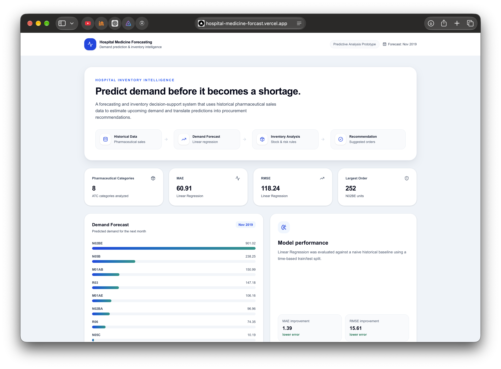
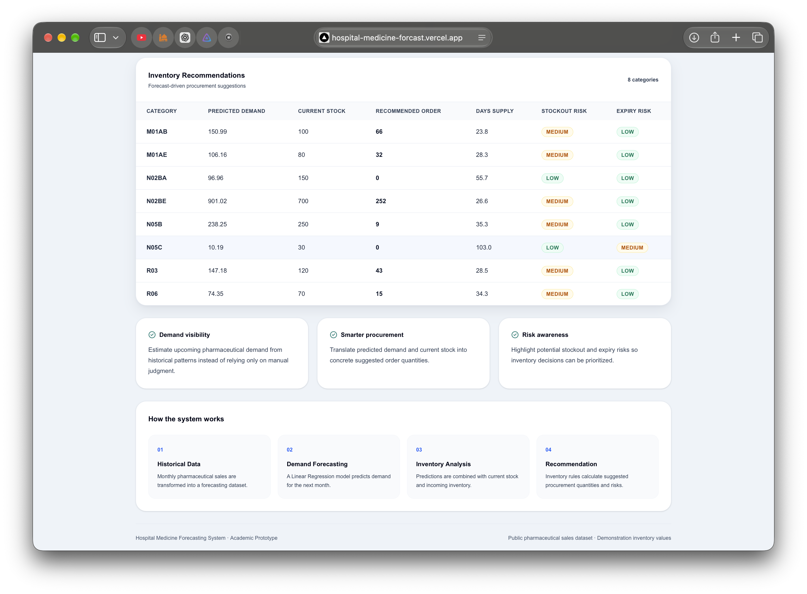
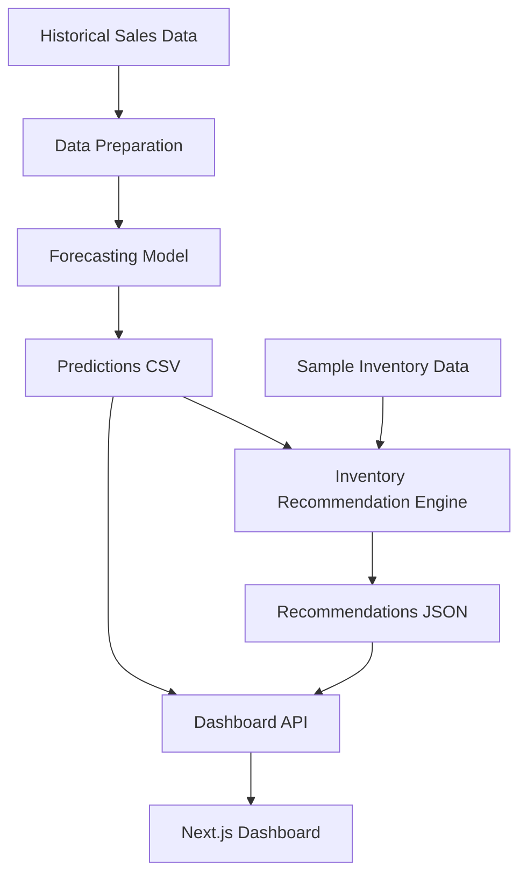

# NEXUS
### Medicine Demand Forecasting & Inventory Intelligence

NEXUS is a machine-learning-powered dashboard designed to forecast pharmaceutical demand and support smarter inventory planning. It combines time-series forecasting with inventory recommendations to help identify potential overstocking, stockout risks, and replenishment needs.

**Forecast demand. Plan inventory. Make better decisions.**

---

## 📸 Project Preview

### Dashboard Overview

Get a consolidated view of predicted medicine demand and inventory insights.



### Demand Forecast & Inventory Insights

Explore category-level demand predictions and the inventory recommendations generated by the system.



---

## ✨ Key Features

- **Demand Forecasting** — Predicts demand for multiple pharmaceutical product categories.
- **Inventory Recommendations** — Uses forecast demand and sample inventory data to suggest replenishment quantities.
- **Risk Identification** — Highlights potential inventory risks to support planning.
- **Interactive Dashboard** — Presents forecasts and recommendations in a clear web interface.
- **Automated Pipeline** — Connects model training, forecast generation, and inventory analysis.

## 🧠 How It Works

1. **Load historical data:** Process monthly pharmaceutical sales data.
2. **Prepare features:** Extract time-based features and historical demand lags.
3. **Train the model:** Evaluate a baseline forecast against a Linear Regression model.
4. **Generate predictions:** Produce forecasts for the next period available in the dataset.
5. **Recommend inventory actions:** Combine forecast demand with sample stock information.
6. **Display results:** Serve the generated outputs through an API to the dashboard.

## 🏗️ Architecture



## 🛠️ Tech Stack

| Area | Technologies |
|---|---|
| Frontend | Next.js, React, TypeScript |
| Styling | Tailwind CSS |
| Data Visualization | Recharts |
| Backend API | Next.js Route Handlers |
| Machine Learning | Python, pandas, NumPy, scikit-learn |
| Testing | pytest |
| Deployment | Vercel, GitHub |

## 📊 Model Evaluation

The forecasting pipeline compares a simple lag-based baseline with Linear Regression using a time-based test split.

| Metric | Baseline | Linear Regression |
|---|---:|---:|
| MAE | 62.30 | 60.91 |
| RMSE | 133.85 | 118.24 |
| MAPE | 46.45% | 48.89% |

Linear Regression improves MAE and RMSE on this evaluation, while MAPE is higher. The results illustrate why forecasting models should be compared using multiple metrics rather than a single score.

## 📁 Project Structure

```text
hospital-medicine-forcast/
├── app/
│   ├── app/
│   │   ├── api/dashboard/route.ts
│   │   ├── page.tsx
│   │   ├── layout.tsx
│   │   └── globals.css
│   ├── data/dashboard/
│   │   ├── predictions.csv
│   │   └── inventory_recommendations.json
│   └── package.json
├── data/
│   └── raw/
│       └── salesmonthly.csv
├── docs/
│   └── screenshots/
│       ├── dashboard.png
│       └── forecast.png
├── output/
├── src/
│   ├── forecasting/
│   ├── inventory/
│   └── integration/
├── tests/
├── requirements.txt
└── README.md
```

## 🚀 Getting Started

### Prerequisites

- Python
- Node.js and npm
- Git

### 1. Clone the repository

```bash
git clone https://github.com/asadasjad/hospital-medicine-forcast.git
cd hospital-medicine-forcast
```

### 2. Set up the Python environment

```bash
python -m venv .venv
```

Activate it on macOS or Linux:

```bash
source .venv/bin/activate
```

Install the Python dependencies:

```bash
pip install -r requirements.txt
```

### 3. Generate forecasts and inventory recommendations

From the repository root:

```bash
python -m src.forecasting.train_model
python -m src.integration.run_pipeline
```

### 4. Run the dashboard

```bash
cd app
npm install
npm run dev
```

Open `http://localhost:3000` in your browser.

## 🧪 Tests

From the repository root, with the Python environment activated:

```bash
python -m pytest -q
```

## ⚠️ Data & Limitations

- The project uses historical monthly pharmaceutical sales data; the forecasts reflect the available dataset rather than current real-world demand.
- The inventory values used in the demonstration are sample data, not a live hospital inventory feed.
- The recommendations are decision-support outputs and should not be treated as clinical or procurement instructions without validation.
- Forecast accuracy may vary by category and evaluation metric.

## 👥 Team

- **Asad** — Data processing, machine learning, and forecasting.
- **Aon** — Inventory logic and backend integration.
- **Yasir** — Frontend and dashboard interface.

## 🔮 Future Improvements

- Integrate live inventory data from a database or hospital system.
- Evaluate additional forecasting models.
- Add confidence intervals and more robust time-series validation.
- Track model performance as new data becomes available.
- Improve inventory recommendations with lead times, safety stock, and expiry constraints.

---

*Built as an academic project exploring machine learning, demand forecasting, and inventory intelligence.*